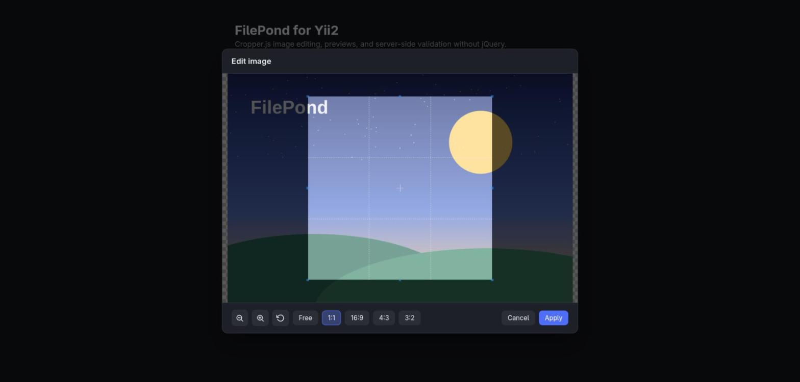
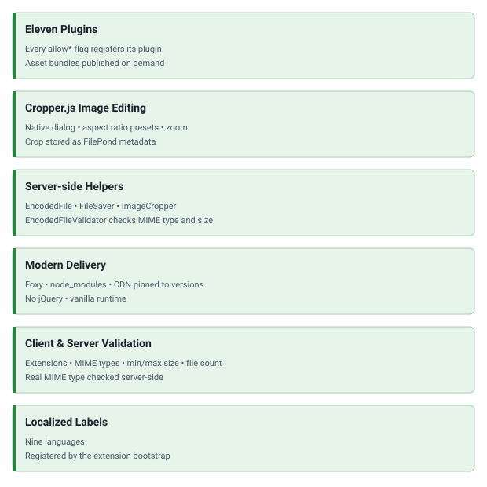

<!-- markdownlint-disable MD041 -->
<p align="center">
    <picture>
        <source media="(prefers-color-scheme: dark)" srcset="https://www.yiiframework.com/image/design/logo/yii3_full_for_dark.svg">
        <source media="(prefers-color-scheme: light)" srcset="https://www.yiiframework.com/image/design/logo/yii3_full_for_light.svg">
        
    </picture>
    <h1 align="center">FilePond</h1>
    <br>
</p>
<!-- markdownlint-enable MD041 -->

<p align="center">
    <a href="https://github.com/yii2-extensions/filepond/actions/workflows/build.yml" target="_blank">
        
    </a>
    <a href="https://dashboard.stryker-mutator.io/reports/github.com/yii2-extensions/filepond/main" target="_blank">
        
    </a>
    <a href="https://github.com/yii2-extensions/filepond/actions/workflows/static.yml" target="_blank">
        
    </a>
    <a href="https://github.com/yii2-extensions/filepond/actions/workflows/security.yml" target="_blank">
        
    </a>
</p>

<p align="center">
    <strong>FilePond file uploads for Yii2 forms</strong><br>
    <em>Cropper.js image editing, previews, client and server validation, no jQuery</em>
</p>

File uploads with image previews, a Cropper.js editor, and server-side validation and storage helpers. The widget
initializes FilePond without jQuery and loads only enabled plugin assets.



## Features

<picture>
    <source media="(min-width: 768px)" srcset="./docs/svgs/features.svg">
    
</picture>

## Quick start

### Installation

Requires the `fileinfo` extension. Foxy 0.4's native manager installs the frontend assets without Node.js or npm; it
requires PHP `zlib` and Composer 2.10.2+.

Set the manager in the application's root `composer.json` before installing:

```json
{
  "config": {
    "foxy": {
      "manager": "native"
    }
  }
}
```

```bash
composer config allow-plugins.php-forge/foxy true
composer require php-forge/foxy:^0.4 yii2-extensions/filepond:^0.2
```

Foxy installs FilePond, its plugins, and Cropper.js in `node_modules` beside the application's `package.json`. Commit
the generated `foxy.lock` with the application's Composer files. Point Yii's `@npm` alias at that directory;
`@app/node_modules` is correct only when the application `basePath` is the Composer project root. See
[installation](docs/installation.md) for alias configuration, existing npm projects, and asset delivery.

### Basic usage

Place this in a Yii view, select a raster image, and edit it with a fixed square selection:

```php
use yii2\extensions\filepond\FilePond;

echo FilePond::widget(
    [
        'name' => 'avatar',
        'acceptedFileTypes' => ['image/jpeg', 'image/png', 'image/webp'],
        'allowImageEdit' => true,
        'allowImageTransform' => true,
        'imageCropAspectRatio' => '1:1',
        'cropper' => ['aspectRatios' => ['1:1']],
        'maxFileSize' => '2MB',
        'config' => ['imageEditInstantEdit' => true],
    ],
);
```

The editor opens when an image is added and offers only the `1:1` ratio preset. Image Transform applies the confirmed
crop before form submission. Previewing a crop alone does not change the uploaded bytes. To receive, validate, and store
the image, follow the [complete upload workflow](docs/uploads.md).

## Documentation

Practical guides and runnable examples for uploads, plugins, and image editing.

- 📚 [Installation Guide](docs/installation.md): native Composer setup, asset paths, translations, and assets.
- ⚙️ [Configuration Guide](docs/configuration.md): option precedence, plugins, and editor behavior.
- 💡 [Usage Examples](docs/examples.md): runnable widgets and helper demonstrations.
- 🧪 [Testing Guide](docs/testing.md): development checks.
- 📤 [Upload Workflow](docs/uploads.md): active form, server validation, cropping, and storage.

Server validation inspects decoded bytes rather than trusting the browser's MIME type. List raster MIME types explicitly
when serving uploads from your origin: `image/*` also accepts SVG. Encoded uploads increase request size; configure the
application's request limits as explained in the upload guide.

The guides and the [API reference](https://yii2-framework.github.io/docs/extensions/filepond/reference/) generated from
the PHPDoc in `src/` are published at <https://yii2-framework.github.io/docs/extensions/filepond/>.

## AI assistance

AI agents: read the [documentation index](https://yii2-framework.github.io/docs/llms.txt) and fetch the Markdown version
of a page by appending `index.md` to its URL. The
[AI agents guide](https://yii2-framework.github.io/docs/project/ai-agents/) covers skill installation, client setup and
verification.

- 🤖 [`yii2-filepond-uploads` skill](docs/agents.md): FilePond uploads.
- 🧭 [`yii2-framework` skill](https://yii2-framework.github.io/docs/guide/skills/yii2-framework/): Yii 22.0 application
  conventions.

The hosted documentation covers Yii 22.0. If it does not match the installed revision or is unavailable, use the
[repository guides](#documentation), the [skill source](skills/yii2-filepond-uploads/SKILL.md), the source PHPDoc and
the [changelog](CHANGELOG.md).

## Package information

[](https://www.php.net/releases/8.3/en.php)
[](https://github.com/yiisoft/yii2/releases/tag/2.0.55)
[](https://github.com/yiisoft/yii2/tree/22.0)
[](https://packagist.org/packages/yii2-extensions/filepond)
[](https://packagist.org/packages/yii2-extensions/filepond)

## Project status

[](https://codecov.io/github/yii2-extensions/filepond)
[](https://github.com/yii2-extensions/filepond/actions/workflows/static.yml)
[](https://github.com/yii2-extensions/filepond/actions/workflows/quality.yml)
[](https://github.styleci.io/repos/719070630?branch=main)

## Our social networks

[](https://x.com/Terabytesoftw)
[](https://www.facebook.com/wilmer.arambula.9)
[](https://www.reddit.com/r/Yii2/)
[](https://t.me/yii_framework_in_english)

## License

[](LICENSE)
